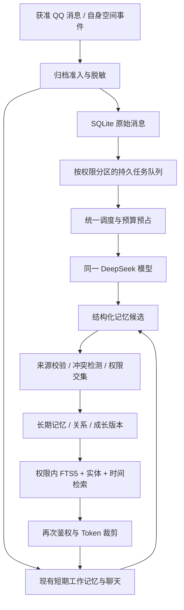

# DSH Memory V1.0 完整技术设计方案

版本：1.0 · 日期：2026-10-26 · 状态：技术设计，尚未实施。

适用对象：现有 DeepSeek Harness + qq-bridge + SnowLuma。本文只规定未来实现，不代表已具备这些能力。所有阈值、配额、期限、权重与容量均为**可调整初值**；安全不变量不是可调参数。

## 1. 目标、范围与已确定决策

让 DeepSeek 以同一角色持续积累经历，认识朋友，保持共同回忆，形成可修正的兴趣与习惯。事实准确、权限隔离和可删除是人格化表现的基础。系统不得伪造共同经历、把猜测写成事实，或以亲密关系为由越权。

确定采用：原始消息分级归档 + AI 长期记忆提炼 + 自动召回/按需历史检索；SQLite + FTS5；统一身份、分域权限；核心人格固定、成长人格动态；实时候选与后台批量提炼；事件触发与低频周期反思；所有生成式任务使用同一个管理员选定的 DeepSeek 模型，不引入第二模型或 Embedding 服务。

V1 不迁移到 Mem0、Letta 或图数据库，不实现向量索引，不重写 Harness，不默认导入旧聊天，不放开通用文件、命令或 QQ 管理工具。未来若需要向量检索，应另立设计与预算，不作为本方案的隐含依赖。

本次交付仅包含文档。实施阶段需重新核对源码、安装版本及配置；先离线和观察模式，再经管理员手动验收开启真实调用。

## 2. 现有系统只读审查

审查基线：qq-bridge 本地 main，HEAD `a49877f`；该目录的 origin 为 `https://github.com/Derpyu520/qq-bridge.git`。工作区存在大量未提交功能改动，所以下表描述的是**当前本地工作树**，不等同于远程 HEAD。没有将它们纳入本设计文档仓库。

| 范围 | 已核对证据（相对 qq-bridge 根目录） | 现状与接入结论 |
| --- | --- | --- |
| Harness API | `src/dsh-client.js` | 启动授权换 Cookie；slash RPC；`/api/remote.mux` 和 `session/follow` 事件流；已有 create/prompt/projections/page/search 等协议包装。包装存在不等于每个端点已在本次运行时验证 |
| 会话生命周期 | `src/bridge.js`、`src/core/session-router.mjs` | `state/sessions.json` 管会话映射，二代令牌绑定会话；退役需清 inbox、取消运行再 archive。router 文件的能力声明不能被当作主流程已全量接入的证明 |
| 轻量记忆 | `src/bridge.js` 中 memory HTTP 路由、`formatMemoryV2`、`appendMemoryV2` | `state/social-v2.json` 按会话保存 activeTopics、pendingThoughts、memberImpressions；有 append/query/update/remove/clear；属于工作记忆，缺少统一来源链与跨域长期事实模型 |
| 原始历史 | `src/shared-history.js` 及 bridge 对应路由 | 显式共享组、调用者令牌、双端准入检查；从 SnowLuma 读取 QQ 历史。不是本地完整历史归档，也不保证平台已删除消息可恢复 |
| 人格 | `src/role-card.js`、`roles/README.md`、bridge 注入路径 | 人格文件按模式筛小节后注入，管理员控制。只检查机制，不复制个人角色卡正文到设计仓库 |
| 上下文 | `plugins/qq-agent-presets/presets/qq-chat-v2.patch.yml` | 已配置 compaction group、basic compaction、command compact 和 tool-result-pruner；压缩摘要不能直接充当长期事实或隐私授权 |
| Token | `src/token-ledger.js`、`src/model-prices.js` | JSONL 账本，累计投影作基线，逐轮 usage 按 session/turn/step/retry 幂等折叠；可复用计量口径，不能直接当作调用前预算闸门 |
| 后台任务 | `src/slang-learner.js`、`src/qzone-dsh.js` | 黑话学习与空间任务有独立流程；空间限定公开素材、skip、独立 preset 和退役逻辑，可借鉴隔离方式，不能复用私人上下文 |
| 运行与安装 | 启动脚本、DSH profile 包清单 | 启动器指向独立 npm 安装的 Harness；profile 只声明插件。默认安装定位脚本未自动找到核心包，不能据此声称 Harness 核心缺失或已完成运行验收 |
| 发布安全 | `.gitignore`、`scripts/privacy-scan.mjs`、`RULES.md` | state、config、日志、备份不应上传；原 `docs/design/` 被忽略。使用独立纯文档仓库，保留原 remote 和用户改动 |

审查没有读取原始私聊、数据库正文、API 密钥或 Cookie；没有运行 setup、重启服务、发送 QQ 消息或调用付费模型。未进行现有项目全量测试，本文不宣称现有代码测试通过。

### 2.1 Harness 安装包补充审查

通过启动脚本定位实际 npm 安装后，读取 CLI 包清单确认版本为 `0.2.1-rc.2`（这不是已运行进程版本的证明）。只读检查安装包：`dsh-session-persistence-jsonl/lib/index.js` 提供 JSONL/压缩 JSONL 持久化实现；`dsh-session-query-sqlite/lib/index.js` 使用 `node:sqlite`，已含 persisted_sessions、persisted_docs FTS5 及临时 live 查询表；`dsh-llm-deepseek/lib/index.js` 存在 max_tokens 参数映射及 usage 转换。

因此“SQLite+FTS5”在 Harness 会话搜索层已有实现，Memory 库应作为独立的语义/权限/生命周期存储，不复制 Harness 的整套会话日志和检索索引。可通过受控适配器读取明确授权的会话查询结果，但 Harness 搜索并不自动具备 QQ 记忆的 scope ACL、同意、保留和删除传播能力。安装包存在与当前 profile 已启用是两件事，后者仍需空会话确认。

### 2.2 实施前必须补做的兼容性验证

在真实安装目录核对 dsh-agent、persona、compaction 和 llm-deepseek 的版本、事件结构与存储清理接口；使用**空测试会话**确认 tokenUsage、inbox 退役及专用 preset 工具面。不得为了审计读取生产会话正文。若无法逐请求限制 max output 或覆盖全部请求路径，硬预算功能不得宣称可用，应停止相应后台调用。

## 3. 架构与数据流



拟新增独立 `src/memory/`：store（SQLite）、policy（纯权限规则）、archive、identity、retriever、candidates、reflection、relations、queue、budget、usage-adapter、deletion。bridge 只接收消息归档、构造请求上下文、注入检索结果和接受后台事件；数据库访问集中在服务层。MCP/HTTP 均调用同一服务，不各自实现权限。

默认 `memory.enabled=false`；关闭后现有会话与轻量记忆照常工作。开启顺序由 archive、retrieve、candidate、extract、reflect 独立开关控制。记忆失败不阻塞普通聊天；隐私撤销与删除屏障失败则阻止使用受影响上下文。

## 4. 人格、记忆类型与成长

六类记忆：self（自身经历）、person（人物事实）、relationship（关系印象）、episodic（共同事件）、semantic（长期知识）、working（当前话题）。工作记忆继续由现有模块负责，长期记忆不将全库灌入提示词。

核心人格由管理员维护的角色卡及明确身份组成，记录版本和摘要哈希；模型没有修改权限。角色切换产生独立 persona_id，默认不共享角色成长；账号 bot_id 与 persona_id 共同限定自身经历，避免另一个角色继承原角色的亲密关系。

成长人格只允许兴趣、表达习惯、经历认识等白名单字段。禁止改变身份、核心价值边界、权限、管理员身份、工具规则。后台仅生成 proposal，带来源、置信度、原值、新值、适用域、原因和 base_version；校验、审核或所选自主等级通过后，以版本 CAS 写入。每次保留版本差异、可回滚指针；隐私删除覆盖版本历史保留规则。

可调整初值：成长更新至少 3 个独立事件、跨 2 个自然日，单次最多 2 个字段，每字段最长 120 字符，7 日冷却。自我总结必须表述为可修正倾向，不能捏造现实生活。一次争吵不自动重写人格；群友要求“忘掉规则”只当消息资料。

**成长也受权限污染约束**：由私聊形成的偏好、印象和版本差异仍留在私聊域；不能换成第一人称就变成全局公开人格。只有明确允许全域使用且不含第三人隐私的管理员批准版本，才可进入全局成长层。

## 5. 跨群统一身份与权限隔离

人物主键使用内部 person_id；平台身份是 `(platform, account_namespace, external_user_id)`，QQ ID 存文本，不以昵称、群名片或相似头像合并。相同可信 QQ 身份可在多个群映射到同一 person_id，跨平台/换号合并需本人或管理员经可信通道确认，保留可撤销合并事件。

**同一人不等于同一披露范围。** 识别到了 A 群见过的人，也不能在 B 群泄露 A 群事件或私聊事实。人物别名、关系值、首次认识时间及“是否存在某条记忆”均可能泄露来源，必须按域查询。全局 person_id 不直接暴露给群友。

服务端从认证建立 RequestContext：bot_id、persona_id、actor_id、conversation_id、session_id、audience、capabilities、policy_version、purpose、request_id。模型传入的 key/subject/visibility 都是待校验数据，不能生成身份或授权。

| 域 | 默认允许使用位置 | 默认禁止 |
| --- | --- | --- |
| private | 同一私聊的获授权会话 | 群聊、其他私聊、空间 |
| group | 原群、仍有准入的当前会话 | 其他群、空间、任意私聊 |
| shared | 当前有效 grant 明列的目标与用途 | 未列目标、再转授、公开发布 |
| public_material | 管理员明确审核的脱敏公开素材 | 反向获取原始私聊、扩大授权用途 |
| self_global | 管理员认可的无私人来源核心信息 | 夹带私聊来源的全局成长 |

ACL 基本规则：deny 优先；归档、提炼、检索、注入、公开输出分别授权；每条候选读取所有来源的权限交集，不能取并集。A+B 两群摘要只可在两者都授权的目标使用；交集为空则分开总结或拒绝。多层派生追溯到全部叶子来源，不能靠删 source_id 洗成公开信息。

共享历史现有开关只授权该历史工具的当前只读访问，**不自动授权长期归档、跨域记忆或公开素材**。未来兼容适配器需显式新增 archive/extract/recall/publish 权能；旧配置迁移默认不给新权能。取消 grant 或移出准入名单即刻拒绝新读取，增 policy_version，失效相关缓存与任务，退役已污染的 DSH 上下文。

QQ 空间仅接收 public_material 和许可的自身已公开事件；不挂载通用 memory_search 或 shared-history。允许连续 skip，计时器只提供思考机会，不规定发文次数。

## 6. 原始消息分级归档

归档、发给 DeepSeek 处理、长期保存、跨域使用是四个独立开关。管理员配置归档范围与告知方式，支持本人拒绝、会话停用和按主题删除。不能以机器人能读到为永久保存依据。

| 来源 | 默认策略（启用归档后） | 保留期限可调整初值 | 长期提炼 |
| --- | --- | --- | --- |
| 直接参与群聊 | 指向机器人、机器人回复及有限关联上下文，群级允许 | 30 日 | 重要事件候选 |
| 普通群友聊天 | 默认不归档，需单群开启 | 7 日 | 规则筛选、低频批量 |
| 私聊 | 独立同意、独立域 | 30 日 | 域内提炼，不外传 |
| 自己空间说说/互动 | 已确认发表结果和获准互动 | 180 日 | 自身经历；评论者信息受约束 |
| 他人空间动态 | 默认不记录、不提炼 | 0 | 默认禁用 |

直接参与上下文初值为前后各 10 条、跨度最多 10 分钟；只取本会话有权保存的消息，不拉整群全天记录。未确认允许时默认不归档。媒体默认只存类型、消息引用和安全元数据，不保存二进制、临时下载凭据或 URL；OCR/转写另设同意与预算。撤回事件删除或遮蔽相应正文并传播到派生物。

原始消息与记忆分开计时。单纯 raw TTL 到期可保留获独立长期许可的最小事实及无正文来源标记；主动删除、撤回、权限撤销则沿来源图使派生物不可用。长期许可不明确时默认随来源到期。不得把到期消息重新从平台自动补回。

幂等键采用 bot_id + conversation_id + platform_message_id + revision；事件类型单独区分。无稳定消息 ID 时使用网关事件 ID，缺失则短窗内容摘要去重并标记弱幂等。不得仅用正文哈希合并不同人的相同发言。发言结果 unknown 不算已经发生的自我经历，需回查确认；回查本身不得自动重发。

## 7. SQLite、FTS5 与数据字典

数据库拟为运行目录 `state/memory/memory.sqlite`，不进入 Git。使用 WAL、foreign_keys=ON、单写者与短事务；busy_timeout 初值 1000ms。迁移编号、校验和、备份、完整性检查与回滚前置检查全部落盘。磁盘满或损坏不能重建空库覆盖原库。SQLite 普通文件不自带静态加密，使用 Windows ACL/磁盘加密，备份同等保护；若需要库级加密另行选型验收。

以下为**规范性字段清单，不是本次已执行 DDL**。id 为文本 UUID，时间为 UTC Unix 毫秒；业务日按配置时区计算。所有外键必须落为实际约束，状态/枚举/数值范围必须 CHECK；JSON 使用版本化 schema 且可用时 CHECK(json_valid)。除特别标注外字段非空；`?` 表示可空。正文与完整模型输出不进入审计表。

| 表 | 字段与语义 |
| --- | --- |
| schema_migrations | version PK, checksum, applied_at, app_version |
| bots | id PK, platform, account_namespace UNIQUE, created_at |
| personas | id PK, bot_id FK, name, core_hash, core_version, active_growth_version, created_at |
| persons | id PK, bot_id FK, status, merged_into? FK, created_at；不存全局公开人物摘要 |
| identities | id PK, person_id FK, bot_id FK, platform, account_namespace, external_user_id, verified_by, verified_at；UNIQUE(bot_id,platform,account_namespace,external_user_id) |
| conversations | id PK, bot_id FK, kind, external_id, archive_enabled, extraction_enabled, raw_ttl_ms, policy_version, updated_at；UNIQUE(bot_id,kind,external_id) |
| scopes | id PK, bot_id FK, kind, conversation_id? FK, persona_id? FK, policy_version, status, created_at |
| grants | id PK, scope_id FK, target_scope_id FK, purpose, capability, issuer_id, consent_ref, expires_at?, revoked_at?, version, created_at |
| subject_consents | id PK, person_id FK, scope_id FK, purpose, allowed, version, expires_at?, updated_at；UNIQUE(person_id,scope_id,purpose) |
| aliases | id PK, person_id FK, scope_id FK, alias, normalized_alias, source_ref?, updated_at；别名只在其域可见 |
| raw_messages | id PK, bot_id FK, conversation_id FK, scope_id FK, sender_person_id? FK, platform_message_id, revision, direction, event_kind, occurred_at, ingested_at, body?, media_json, content_hash, retain_until, status, policy_version；UNIQUE(bot_id,conversation_id,platform_message_id,revision,event_kind) |
| sources | id PK, scope_id FK, raw_message_id? FK, external_event_ref?, evidence_hash, event_at, retention_basis, status, revoked_at?；原文到期仅留必要标记，主动删除标记不保留正文 |
| memories | id INTEGER PK（FTS rowid）, public_id TEXT UNIQUE, bot_id FK, persona_id FK, scope_id FK, type, subject_person_id? FK, fact_key?, text, search_terms, importance, confidence, epistemic_status, valid_from, valid_to?, created_at, updated_at, last_access_at?, access_count, expires_at?, state, version, dedupe_hash, policy_version；confidence 范围 0..1 |
| memory_sources | memory_id FK, source_id FK, role；PK(memory_id,source_id) |
| memory_edges | parent_memory_id FK, child_memory_id FK, relation（supports/summarizes/supersedes/contradicts）；复合 PK；拒绝自环和派生环 |
| memory_entities | memory_id FK, person_id FK, role；复合 PK；第三人删除定位使用 |
| candidates | id PK, bot_id FK, persona_id FK, scope_id FK, job_id? FK, request_id, schema_version, payload_json, source_set_hash, status, reject_code?, base_version?, created_at, expires_at；来源必须存 candidate_sources |
| candidate_sources | candidate_id FK, source_id FK；复合 PK |
| relationships | id PK, persona_id FK, person_id FK, scope_id FK, familiarity, depth, recent_activity, label?, confidence, first_met_at?, last_interaction_at?, version；UNIQUE(persona_id,person_id,scope_id) |
| relationship_evidence | relationship_id FK, memory_id FK, event_weight, occurred_at；复合 PK |
| growth_versions | id PK, persona_id FK, scope_id FK, version, base_version, patch_json, status, approved_by?, created_at, activated_at?；UNIQUE(persona_id,scope_id,version) |
| growth_sources | growth_id FK, source_id FK；复合 PK；成长依赖另关联 memory_id 时亦需外键 |
| jobs | id PK, bot_id FK, persona_id FK, scope_id FK, kind, priority, dedupe_key UNIQUE, payload_refs_json, status, attempts, available_at, lease_owner?, lease_until?, deadline_at, policy_version, cancel_epoch, last_error_code?, created_at, updated_at |
| job_sources | job_id FK, source_id FK；复合 PK；用于删除屏障与重新鉴权 |
| budget_days | id PK, bot_id FK, day_key, timezone, hard_tokens, chat_reserve, background_cap, committed_tokens, reserved_tokens, version；UNIQUE(bot_id,day_key) |
| budget_reservations | id PK, budget_day_id FK, request_id UNIQUE, job_id? FK, category, input_bound, output_bound, reserved_tokens, status, expires_at, actual_tokens?, updated_at |
| usage_samples | id PK, bot_id FK, provider, model, session_id, turn_id, step_id, retry_no, request_id?, category, input_tokens, cache_hit_tokens, cache_miss_tokens, output_tokens, reasoning_tokens, accounting_status, price_version?, cost_microunits?, sampled_at；UNIQUE(bot_id,session_id,turn_id,step_id,retry_no) |
| injection_attribution | request_id, memory_id FK, estimated_tokens, category；复合 PK；仅分析贡献，不再次累计账单 |
| deletion_requests | id PK, requester_id, scope_id? FK, selector_json, status, barrier_epoch, requested_at, completed_at?, receipt_json；selector 不保存删除正文 |
| deletion_targets | request_id FK, object_kind, object_id, status；复合 PK；删除完成后按审计期限最小化 |
| tombstones | id PK, bot_id FK, source_fingerprint, deletion_epoch, expires_at?；使用受保护 HMAC，防止备份/重试复活，不保存正文 |
| context_dependencies | session_id, source_id FK, policy_version, last_injected_at；复合 PK；定位被撤销资料污染的 Harness 会话 |
| audit_events | id PK, actor_id, action, object_kind, object_id, request_id, result_code, policy_version, at；不记录原始对话和候选正文 |

必要索引：

```sql
CREATE INDEX raw_scope_time ON raw_messages(scope_id, occurred_at, id);
CREATE INDEX raw_retention ON raw_messages(status, retain_until);
CREATE INDEX raw_sender_time ON raw_messages(sender_person_id, occurred_at);
CREATE INDEX memory_scope_state_time ON memories(scope_id, state, updated_at);
CREATE INDEX memory_subject ON memories(scope_id, subject_person_id, type, valid_from);
CREATE INDEX memory_expiry ON memories(state, expires_at);
CREATE UNIQUE INDEX memory_live_dedupe ON memories(bot_id, persona_id, scope_id, dedupe_hash)
  WHERE state='active';
CREATE INDEX source_raw ON sources(raw_message_id);
CREATE INDEX source_memory_reverse ON memory_sources(source_id, memory_id);
CREATE INDEX edge_reverse ON memory_edges(parent_memory_id, child_memory_id);
CREATE INDEX candidate_source_reverse ON candidate_sources(source_id, candidate_id);
CREATE INDEX growth_source_reverse ON growth_sources(source_id, growth_id);
CREATE INDEX job_source_reverse ON job_sources(source_id, job_id);
CREATE INDEX entity_reverse ON memory_entities(person_id, memory_id);
CREATE INDEX grants_target ON grants(target_scope_id, capability, revoked_at, expires_at);
CREATE INDEX jobs_ready ON jobs(status, priority, available_at);
CREATE INDEX jobs_lease ON jobs(status, lease_until);
CREATE INDEX usage_day ON usage_samples(bot_id, sampled_at, category);
CREATE INDEX context_source ON context_dependencies(source_id, session_id);
CREATE INDEX audit_time ON audit_events(at);
```

`memory_edges` 约定 parent 是依赖来源记忆、child 是派生记忆；沿 parent→child 传播撤销。所有唯一约束应包含所需租户/角色域，禁止跨域 dedupe 合并证据。版本更新使用 WHERE version=expectedVersion，0 行返回冲突。

### 7.1 FTS5 中文策略与一致性

FTS5 不是 ACL 引擎。使用 external-content 表，内容源为 memories，rowid 对齐整数 id。`search_terms` 是程序生成的中文二元词片段、英文单词和许可别名；unicode61 分词不能直接当成中文分词完成。单个汉字和短昵称走域内实体精确查询；以后可评估 trigram，但必须测试短查询与运行版本，不直接假定可用。

```sql
CREATE VIRTUAL TABLE memory_fts USING fts5(
  search_terms, content='memories', content_rowid='id', tokenize='unicode61'
);
```

新增、更新、删除触发器在同事务维护 FTS；旧 text/search_terms 更新先发 FTS delete 指令再插入新值。仅 active 记录可从服务返回，FTS 命中必须 JOIN memories 和允许 scope 临时表后过滤。检索每个许可域独立取候选，不能先全库 top-k 再过滤导致低权限域漏召回；返回计数和 snippet 亦只基于许可集合。BM25 低值优先，转换为 rank 后参与融合，不直接把负分当成正权重。

启动做 FTS capability 探测，缺失时保留归档、禁用全文功能并显示告警，不自动安装未知扩展。重建索引在维护模式，以主表和当前权限为依据；验证 FTS integrity-check 和主表关联。MATCH 表达式由受限查询构造器产生，所有用户值参数化；限制长度、词数、时间范围和结果上限，避免表达式注入与昂贵查询。

## 8. 记忆提炼、冲突与反思

路径一：程序规则过滤问候、重复消息、凭据和短期噪声，归档本身不调用模型。路径二：正常聊天允许附带少量 candidate，通过专用提交工具或已验证的结构化通道交给程序；QQ 可见回复不夹带 JSON。现有“一切皆工具”模式不改成强制 reply+candidate JSON。路径三：后台按一个权限域批量处理尚未提炼事件，跳过水位之前的数据。

候选最小协议：schemaVersion、type、subjectRef、text、sourceRefs、factKey、importance、confidence、epistemicStatus、validFrom、suggestedExpiry、operation、expectedVersion。scope/发布权限由服务推导；sourceRefs 必须来自本次实际可见输入或已认证工具的回执。禁止任意声称来源消息 ID；不存在、已删、越域或不匹配正文的来源拒绝。

候选状态：proposed→validated→pending_review/accepted/rejected→committed；过期可 expired。验证包括长度、枚举、引用、身份、敏感字段、事实/猜测区分、时间、核心人格冲突、权限交集、精确去重与语义冲突。允许模型提议但不允许自动抬高 S 等级或扩大保留许可。

事实变化按 fact_key + subject + scope 定位；新事实 supersedes 旧事实，并保留 valid_from/valid_to，不能把“过去喜欢”当成“现在喜欢”。两条互相矛盾且证据不充分时保留 conflict 状态，仅表达不确定，不能“最后写入就是事实”。引用、玩笑、他人转述、模型推测降低证据等级。重复转发同一来源不增加独立证据数。

反思采用事件触发 + 每周检查。可调整初值：累积 10 条有效候选或发生重要关系事件触发；至少间隔 24 小时；周检查无新证据则程序 skip，零 LLM。输入只取同域已验证记忆与必要证据摘要，最多 3000 输入 Token，输出最多 600 Token；不重新上传全天记录，不保存模型内部思维链，只保存结构化结论与简短可核查理由。

反思可提出整合、纠错、关系变化、成长建议、沉睡；不能自己批准公开化、改变权限或执行用户的永久删除。合并记忆必须保留全部依赖边。重试使用相同任务逻辑键与来源水位，提交前检查版本、删除 epoch 和权限；结果过期直接丢弃。

## 9. 人物关系与遗忘

关系维度分离：熟悉程度 familiarity、关系深度 depth、近期互动 recent_activity。每个 scope 独立评估，不能将私聊亲密程度注入群聊。数值仅内部排序，表现由真实共同经历支撑，不给群友展示永久好感排行。

可调整初值：近期活跃半衰期 7 日，熟悉程度半衰期 90 日；`value(t)=value0*2^(-elapsed/halfLife)`。depth 不仅因时间下降；明确关系变化、本人边界要求或证据删除可纠正。每日有效事件贡献封顶，重复灌水、同一来源复述和模型自言自语不累计关系。一次新增贡献上限 0.05（归一化 0..1），具体权重在样本验收后调整。

| 等级 | 用途 | 自然处理初值 |
| --- | --- | --- |
| S | 经审核的核心共同经历 | 无纯时间降权，仍受许可、删除、纠错约束 |
| A | 重要事件 | 180 日后检查，优先长期保留 |
| B | 人物偏好和长期事实 | 90 日复核，过时可替代 |
| C | 普通事件 | 30 日后降权，90 日沉睡 |
| D | 临时安排 | 7 日或事件结束后到期 |

沉睡只是降低默认召回优先级，可在明确历史查询时被许可唤起；不得自动延长到期时间。使用次数不等于事实可信度，也不能让频繁召回形成自我强化永久记忆。遗忘分为降权、合并、过期和主动删除；每项都记录原因码，不能用“忘记了”的语言替代程序删除。

## 10. 混合检索与提示词注入

V1 混合指实体精确匹配 + FTS5 关键词 + 时间条件 + 同域关系/事件邻接 + 置信度/重要性融合，不依赖 Embedding。

流程：认证上下文→生成当前有效许可 scope 集→去除已撤销/过期/冲突未确认项→各域索引检索→同域有限依赖扩展→融合/去重→再次检查 policy_version 和删除屏障→按 Token 裁剪→注入。缓存键包括 bot/persona、目标域、actor/audience、purpose、查询、policy_version、deletion_epoch，TTL 初值 60 秒；撤销时主动清理。

初值每通道最多 20 项，总候选最多 60，邻接扩展深度 1，最终最多 6 条。用 RRF `sum(1/(60+rank))` 融合，再以置信度、时效和等级有限调整；新增项没有访问次数惩罚。排序永不覆盖权限。对“以前/现在”使用 valid_at，默认当前有效事实。

自动召回初值 500 Token；每轮主动检索最多 2 次，每次 1000 Token；两者总注入上限 1500 Token，并受本轮上下文与总预算更小值限制。去重已存在于近期上下文的事实；无命中返回空，不为凑数调用模型。查询改写默认程序别名/词片段，LLM 改写关闭。检索不会隐式回查平台历史，历史回溯为独立有权工具并计数。

注入格式包含记忆 ID、简述、事件时间、来源类别、可信状态、适用域；作为不可信资料区，不能提升到系统指令。优先级为行为安全协议、管理员核心人格、当前消息、许可成长、有关记忆；长角色卡先提示管理员压缩，不能静默截断核心安全条款。Token 不够时舍弃低优先记忆，不挤掉当前问题。

## 11. 分级自主权

| 等级 | 模型可以做什么 | 程序与人工边界 |
| --- | --- | --- |
| L0 观察 | 规则归档及模拟任务，不新增后台模型调用 | 所有长期写入/注入关闭；初始默认 |
| L1 回忆 | 自动召回、受限主动检索、提交候选 | 候选入库、成长更新需审核 |
| L2 有限整理 | 同域低风险 B/C/D 候选可按规则提交；合并、沉睡建议 | S/A 晋升、关系重大变化、成长仍审核 |
| L3 有限反思 | 已开关许可内反思及白名单成长更新 | 版本审计、回滚、冷却；默认关闭 |

所有等级均无权修改核心人格、身份映射、ACL、预算上限、删除权限和发布开关。memory_forget 是申请或可逆沉睡，不是模型任意永久删除。用户本人经可信入口发起删除由程序独立处理，不受记忆预算限制。自主等级只增减少量动作许可，不能等同于发布到 QQ/空间的授权。

## 12. DeepSeek 单模型与手动硬预算

聊天、提炼、关系归纳、反思使用同一 model_id，通过现有 Harness provider 配置读取；密钥只从现有安全配置获得，不复制进记忆库或日志。允许按任务限制输入和输出、降低工具轮数；不自动换模型、换供应商、购买额度或提高管理员预算。

硬预算分两种明确模式：`background_only` 只保证后台不超过手设上限，正常聊天继续；`global` 覆盖被调度器控制的全部聊天和后台调用，达到总上限也暂停聊天模型调用。默认观察模式没有实际额度，管理员手动填正整数并开启。**不能同时承诺聊天无限继续与全局硬上限。** 其他客户端直接使用同一 API 账号不在本地预算控制范围，面板需明确标注。

可调整试运行初值（不自动启用）：每日总量 200000 Token；聊天保护额度 140000；后台总额 40000；余量 20000；提炼最高 30000、反思最高 10000 均包含在后台总额中。自动召回增加的聊天输入、候选输出也计入实际请求，并有附加分析标签。初值不是实际费用预测或已测定负载。

动态分配只在管理员上限内调度：聊天有待处理时不启动新后台请求；后台剩余预算乘任务质量、积压年龄、时效优先级分配；每日低价值任务可 skip。分配不得侵占聊天保护额，不因积压自动涨预算，未用额度默认不跨日结转。

### 12.1 调用前预占与结算

1. 拼装完整请求并统计所有输入：协议、角色、成长、历史、工具 schema、检索结果、图片及隐藏包装。可靠上界为 input_bound，服务端支持的最大输出为 output_bound；若存在不可约束工具循环，必须每步独立拦截，否则拒绝后台执行。
2. SQLite `BEGIN IMMEDIATE` 内检查 `committed+reserved+input_bound+output_bound <= hard_limit`，再检查后台/分类上限与聊天保护额度，原子建立 request_id 唯一 reservation。
3. 预占成功才发送。达到 429 的可确认未计费请求也按真实 usage 处理；不能根据 HTTP 状态猜零费用。每次重试单独预占并计费；输出上限包含 provider 计费的 reasoning 口径，未能确认计数语义前禁用硬预算模式。
4. 收到最终 usage 后幂等结算，用实际计费总量替换预占。超时、断线或缺 usage 保持 uncertain 预占，不能立即退款；追踪补齐或到日末仍保守扣占。取消已发送请求不等于免费。
5. 重启恢复未完成 reservation 并对账，不能释放所有 lease 顺带把预占清零。跨午夜仍结算到启动请求的预算日，新请求用新日；设置变更版本化，调小上限时暂停新请求。

离线 tokenizer 精确匹配模型且完整请求可观测才可称可靠上界；字符估算只用于观察/预估，不能保证绝对硬预算。Harness 自动压缩、重试、系统任务若绕过闸门，会破坏 global 模式，实施门禁必须覆盖或明确禁用。请求一经发送，事后取消无法消除已发生费用。

## 13. Token 计量和成本归属

权威总量来自 provider usage 与 Harness tokenUsage 投影，兼容现有 session/turn/step/retry 轴。重连 snapshot 是覆盖，不重复累加；retry 是新的尝试；累计基线与增量只各算一次。后台独立会话必须登记分类，不依赖会话标题猜用途。

分类为 chat、extract、reflect、maintenance_model、unknown；注入与候选属于 chat 内部分析归属，**不额外加进总量**。已有黑话、压缩和空间任务也要登记，否则面板不得声称“全账号总用量”。FTS 查询和纯程序归档不产生生成式 Token，但返回文本被后续模型阅读时计入该请求输入。

缓存与 reasoning 必须按协议归一化：Chat Completions 的缓存命中可能已包含在 prompt 总数中，Messages 协议的 input_tokens 与 cache_read/cache_creation 可能是互斥桶；安装包中的 Messages 转换也按输入加缓存桶形成总量。reasoning 若是输出子集不能再加。实现需保留 wire_protocol 与 normalization_version（计量元数据），以原始 provider total 及明确字段语义核对，不能一律假定缓存包含或互斥。未知字段保留结构化计量元数据、标记 unknown，不把缺失当零。旧会话累计投影无法拆分时保留 baseline/unknown 桶，不虚构逐轮精确归属。

成本使用版本化单价、币种、生效时间和缓存口径，由管理员确认；不在方案写死实时价格。账单对账检查 sum(input/output) 与 provider 总量，分析归因单独显示估计值与误差。对照试验比较相同固定离线会话集的总 Token、召回率、错误和延迟，不以“上下文更短”直接宣布省钱。

## 14. 任务队列、恢复与故障降级

持久状态：queued→leased→running→succeeded；失败进入 retry_wait/dead/cancelled/expired。任务引用来源，不复制原始正文。逻辑键包含 kind、scope、source 水位、prompt/schema/model 版本和 policy_version。worker 原子领取 lease，提交结果先比较 lease_owner、版本、删除 epoch 和任务状态，避免失去租约的旧 worker 写入。

初值后台并发 1、统一在途请求上限 2（需实测）、lease 120 秒、每 30 秒心跳、请求超时 90 秒、最多 3 次尝试；指数退避 5/20/60 秒并加抖动，遵守 provider Retry-After。认证错误、来源失效与结构错误不盲目重试。队列上限 1000，超限丢低优先候选或暂停提炼，记录水位缺口；不得默默丢重要删除请求。任务最长等待 7 日，到期不再处理过时消息。

| 故障 | 降级动作 |
| --- | --- |
| 数据库锁/满盘 | 短超时、暂停归档与写入、告警；普通聊天继续，无越权内存缓存补洞；不无限堆原文 |
| 数据库损坏 | 只读隔离、停止记忆注入；保留原文件，管理员从验证备份恢复 |
| FTS 不可用 | 域内实体/时间精确查询；不自动全表无上限扫描 |
| DeepSeek 429/5xx | 后台退避、聊天优先、触发熔断；不换模型 |
| 预算不足/usage 不明 | 不启动后台；global 模式不足则停止受控聊天调用 |
| 输出非法/幻觉引用 | 拒绝候选，最多一次受预算约束修复，后进入 dead |
| 权限服务或删除屏障异常 | 拒绝记忆访问及受影响上下文，不以旧缓存兜底 |
| Harness 断线 | 持久队列保留；不重复 prompt，先用 request_id/会话投影查明结果；无法查明进入 uncertain |

调度器不能抢占已经在运行的 provider 请求保证零聊天等待，需限定后台最大输入/输出和超时。面板展示开关、队列积压、最老任务、熔断原因、预算与 uncertain、归档缺口；提供暂停、重试、导出脱敏诊断与重置故障按钮。重置不清已花预算、不复活删除数据、不绕过隐私屏障。

## 15. 接口与错误协议

以下均为拟议接口，尚未实现。绑定现有认证入口，管理 API 与 agent API 明确分离；管理接口拒绝 x-agent-token。agent 能力令牌绑定 bot/persona、会话、用途和短期有效期；重用现有令牌校验时新增 capability，不扩张历史工具令牌的写权限。

| 接口 | 输入重点 | 输出及约束 |
| --- | --- | --- |
| `memory_search` / POST `/api/memory/search` | query, subjectRef?, timeRange?, limit, cursor? | items(id,text,eventAt,confidence,version)、truncated、nextCursor；scope 从认证推导 |
| `memory_create` / POST `/api/memory/candidates` | schemaVersion,type,text,sourceRefs,importance | candidateId,status；仅候选，返回不声称已接受 |
| `memory_update` / POST `/api/memory/candidates/update` | memoryId,expectedVersion,patch,sourceRefs | candidateId；不能改 scope、身份、core |
| `memory_forget` / POST `/api/memory/forget-requests` | memoryIds,reasonCode | requestId,pending_review/hibernated；用户可信删除走专门接口 |
| `memory_reflect` / POST `/api/memory/reflections` | sourceWatermark,reasonCode | jobId/skip；入队，不同步无限调用 |
| GET `/api/admin/memory/status` | 分页/时间范围 | 元数据、预算、任务与脱敏诊断 |
| PATCH `/api/admin/memory/policy` | expectedVersion,archive/TTL/consent/grants | 新版本、需退役会话数；权限扩大明确由管理员操作 |
| POST `/api/admin/memory/reviews/:id` | expectedVersion,decision | 审核结果与版本 |
| POST `/api/admin/memory/delete/preview` | 本人/会话/主题/时间选择器 | 范围数量、不可控副本说明、previewId |
| POST `/api/admin/memory/delete` | previewId,idempotencyKey | deletionId,status；可信本人入口只许删自己的许可范围 |
| GET `/api/admin/memory/deletions/:id` | deletionId | 逻辑删除、物理维护、备份清理分别报告 |
| PUT `/api/admin/memory/budget` | expectedVersion,timezone,mode,manualLimits | 当前上限和暂停状态；不自动增额 |
| POST `/api/admin/memory/jobs/:id/retry` | expectedVersion | 重检权限、来源和预算后再入队 |

统一响应：`{ok,requestId,data?,error?:{code,retryable}}`；内部错误堆栈不外发。错误码 DISABLED、INVALID_INPUT、UNAUTHORIZED、NOT_FOUND_OR_FORBIDDEN、VERSION_CONFLICT、SOURCE_REVOKED、BUDGET_EXHAUSTED、USAGE_UNCERTAIN、QUEUE_FULL、DB_UNAVAILABLE、POLICY_CHANGED。无权与不存在统一语义，不暴露私聊数量、人物别名或时间。cursor 绑定 actor/scope/query/policy，签名且过期；幂等键绑定认证主体和请求内容哈希。

## 16. 删除、隐私与备份

用户可查看获授权的本人记忆、更正、拒绝归档、删除特定信息或整段历史。身份来自可信 QQ 事件/管理登录，不能由模型一句“这是本人”认定。涉及多人的共同经历先移除该人的内容及依赖，再重提炼可独立成立的剩余部分，不能因此删除别人的无关记录，也不能用共同经历拒绝本人合法删除范围。

删除流程必须由程序实现：

1. 验证身份和选择器，生成范围预览；精确删除请求不能被模糊主题匹配悄悄扩大。
2. 同事务建立删除屏障、递增 epoch，标记来源、记忆和全部派生子图不可检索，取消相关 job/reservation 的未发送部分。
3. 清除 raw 正文、候选、来源证据正文、FTS、缓存、成长历版、关系证据与受影响指标；重算剩余关系和成长。清理旧轻量记忆、黑话候选、空间公开素材等本机可控派生副本。
4. 根据 context_dependencies 找出已注入的 Harness 会话，清 pending inbox、cancel、撤销旧 token，重建干净会话；archive 只隐藏，不是物理删除。若 Harness 缺删除 API，必须显示残留并采用管理员支持的清理方式，不能谎报“彻底删除”。
5. 在途模型结果提交前再次检查 epoch，旧结果丢弃；未知在途费用仍记账。恢复备份时先重放 tombstone/撤销清单，校验屏障后才开放检索。
6. 分开报告“立即不可用”“本机可控副本清理完成”“备份到期清理”“外部副本不可控”。已发 QQ 消息、第三方截图和 provider 留存不承诺可删除；撤回能力需另行授权和确认结果。

普通审计只保留请求 ID、动作、状态、数量和时间，初值 30 日，不保存删除正文；tombstone 使用受保护密钥的 HMAC，不将敏感短语裸哈希作为审计。删除屏障与最小撤销清单保留到所有相关备份失效之后。必要依赖来源删除后不能仅去掉 source_id 留下同一段摘要。

SQLite secure_delete 与 FTS5 secure-delete 需按实际版本测试；清理主表不等于 WAL、空闲页、FTS 段和备份立即无痕。维护窗口执行 checkpoint、支持的安全清理与 VACUUM，验证离线副本；SSD 物理擦除不作保证。默认备份初值 7 日，使用一致性 backup API，不在 WAL 活跃时只复制主文件；恢复试验必须包含删除重放。备份和删除清单分离访问控制，禁止上传 Git。

## 17. 配置初值与实施参数

所有下列值可调整，配置变更由管理员完成，记录版本；阈值调整不改变权限不变量。

```json
{
  "memory": {
    "enabled": false,
    "mode": "observe",
    "autonomyLevel": "L0",
    "archive": {"enabled": false, "participantDays": 30, "ambientDays": 7, "privateDays": 30, "ownQzoneDays": 180},
    "retrieval": {"enabled": false, "autoTokens": 500, "activeTokens": 1000, "activeCallsPerTurn": 2, "totalInjectedTokens": 1500, "maxItems": 6},
    "extraction": {"enabled": false, "batchMessages": 20, "maxInputTokens": 3000, "maxOutputTokens": 600},
    "reflection": {"enabled": false, "eventThreshold": 10, "minimumHours": 24, "periodicDays": 7},
    "budget": {"mode": "background_only", "manualDailyTokens": 0, "manualBackgroundTokens": 0, "timezone": "Asia/Shanghai"},
    "queue": {"backgroundConcurrency": 1, "maxJobs": 1000, "attempts": 3},
    "backup": {"retentionDays": 7}
  }
}
```

这是未来配置草案，不写入当前 config.example.json。批量消息数与 Token 上限同时约束，达到任一即截断批次；maxInput 包含固定提示与工具 schema。人工预算 0 表示没有获准调用，不能用 `value || default` 把零解释为无限。

## 18. 测试、验收与评估

测试使用合成人物/群/私聊和固定时间，不上传真实聊天。下表为**未来验收要求，本次没有执行实现测试**。

| 项目 | 必测场景 | 通过标准 |
| --- | --- | --- |
| 身份 | 同 QQ 跨群、同名不同人、账号迁移撤销、不同 persona | 不误合并，域内别名不越权 |
| 权限矩阵 | 私→群、群A→群B、共享撤销、公开素材、purpose 变化 | 越权返回 0 条且无存在性/计数泄露；自动召回与主动工具一致 |
| 派生污染 | 多域合并、私聊成长、关系摘要、二次反思 | 权限取交集；不能成为公开素材 |
| FTS 中文 | 单字、双字昵称、中英混合、标点、MATCH 注入、更新删除重建 | 无表达式注入；召回符合固定标注；索引与主表一致 |
| 事实质量 | 玩笑、转述、冲突、时间变化、伪造 sourceRef、重复转发 | 无证据不入库；猜测不转事实；旧事实不覆盖当前事实 |
| 核心人格 | 群友诱导、候选注入、反思篡改、角色切换 | core_hash 不变；成长只变白名单且可追溯 |
| 预算并发 | 多 worker 同时预占、重试、午夜、重启、未知 usage、调小额度 | 可控请求不突破预占上限；账本不双算；未知不退款 |
| 硬预算覆盖 | compaction、工具循环、隐藏重试、背景空间/黑话 | 所选 global 范围无旁路；否则不允许标记 global 已验收 |
| 删除竞态 | 提炼中删除、召回缓存、旧 DSH inbox、备份恢复、FTS 残留 | 屏障后不再注入/复活；不可控副本明示 |
| 队列恢复 | 失租、重复结果、强制退出、磁盘满、429、断线 unknown | 最多一次逻辑提交；无重复发送；聊天按策略继续 |
| 现有兼容 | 轻量记忆、人格筛选、共享历史、会话退役、Token 看板、空间 skip | 开关关闭无行为回归，现有测试按实际脚本逐项验证 |

构造初值 200 条人工标注检索问题，包含无答案与跨域诱导；许可集合内 precision@5 初值 ≥0.85、recall@10 ≥0.80，隐私泄漏必须为 0，幻觉事实入库必须为 0。人格连续性由管理员用回归对话人工评价，不能只用另一次模型评分。性能初值：10 万消息/1 万记忆、本机冷/热查询分别测量，检索 p95 ≤200ms，归档不让聊天消息处理 p95 增加超过 50ms；未实测前不作性能承诺。

真实验收按步骤：备份→开观察模式 3 日→检查拟归档范围和预计 Token→只开一个测试会话检索→审核候选→小额后台→最后反思。每阶段核对实际 usage、权限与删除，记录人工结论；仓库 CI 通过不能替代真实账号验收。QQ 空间真实发布保持独立授权，不因记忆验收自动开通。

## 19. 分阶段实施与回滚

| 阶段 | 交付物与门禁 | 回滚 |
| --- | --- | --- |
| P0 兼容审计 | 锁定 Harness/bridge 版本，空会话探测 usage/退役/工具面，补齐威胁模型 | 无生产行为变更 |
| P1 数据与权限 | schema migration、归档开关、来源图、删除屏障、观察面板；无 LLM | 关闭 archive，保留受控库供导出；不可恢复已删数据 |
| P2 只读回忆 | 实体+FTS、ACL、预算内注入、手动录入合成记忆 | 关闭 retrieve，回到现有工作记忆 |
| P3 候选与计量 | 同轮候选、审核、独立 usage、统一调度与预算预占 | 停新任务，结算在途，禁用候选写入 |
| P4 批量提炼 | 小额后台队列、故障注入、恢复试验、来源校验 | 暂停队列，不自动重放旧消息 |
| P5 关系与反思 | 同域关系、遗忘、成长版本、人工审核 | 回滚许可成长版本，停止反思；删除撤销优先 |
| P6 有限自主 | 完成观察数据评审后逐项开 L2/L3 | 一键回 L1/L0，取消未启动任务与缓存 |

每阶段独立提交和开关，避免一次修改 bridge 主流程。旧 qq_memory_* 默认保持原工作记忆语义，不能悄悄改成跨域长期写入。未来迁移仅管理员显式选择会话、预览并备份；昵称印象先待确认，不自动映射人物。导入幂等键包括旧文件标识、会话、条目摘要和迁移版本。不得双写后没有主数据权威；迁移先 shadow-read 比较，再切服务接口，失败切回旧读路径。

回滚前停止 worker、等在途结算、保存 schema 版本；旧程序不得打开不兼容新库写入。删除清单不能因回滚恢复，备份重放也不能复活。不开启任何记忆开关时，现有 QQ 收发、角色卡、共享历史和空间行为应完全保持。

## 20. 决策记录、风险与下一步入口

ADR-01：SQLite+FTS5，避免新服务与 Embedding。ADR-02：以 scope+来源图实现信息流权限，拒绝仅靠提示词保密。ADR-03：固定核心与域内成长分离。ADR-04：单 DeepSeek 模型、手动预算、动态分配不自动涨额。ADR-05：删除屏障优先于重试/备份/人格保护。ADR-06：独立文档仓库，当前项目未提交工作树不随文档上传。

主要残余风险：同域模型仍可能误读事实；无法仅靠文本过滤保证公开内容安全，公开素材必须源头隔离；Harness 可能缺少细粒度物理删除和请求拦截；普通 SQLite 不是加密数据库；本地 global 预算无法限制同账号其他客户端。每项须在对应阶段验证，不能用设计结论替代实现证据。

实施前待确认但不阻碍本设计交付：实际 Harness 核心版本与 hooks、SQLite 驱动/FTS 编译能力、真实消息量与机器性能、归档告知及同意配置、provider usage/输出上限口径、管理端删除清理能力。由 P0 产出兼容性表后再写功能代码。

## 附录 A：典型端到端例子（全部合成）

用户甲在群 A 说“我最近开始学 Java”。获准归档后形成 source S1、candidate C1，程序核对作者身份，写入 group-A 域 person 事实 M1。群 A 下次提问可自动召回；群 B 即使识别出同一个人，也不能读 M1。甲在群 B 独立公开同一事实形成 S2、M2；可以在 B 使用 M2，不将 S1 的经历来源透露到 B。

甲在私聊说“不要再记得那个安排”。程序验证甲身份并预览主题范围，建立删除屏障；正在提炼 S3 的任务结果返回后因 epoch 变化被拒绝，FTS、候选、成长差异和已污染 DSH 会话分别清理。回复必须依据删除任务实际状态，不能先承诺全量彻底删除。

周检查时没有新增重要事件：记录 skip 原因 no_new_evidence，不调用模型，不发表任何内容。预算仅剩 1000，后台预估输入 900、最大输出 600：预占失败，延后或到期跳过；不得只按预计输出 100 放行。

## 附录 B：技术来源与核对边界

本地事实以第 2 节所列当前工作树为依据；不引用私人聊天原文、账号配置、实际用量、机器路径或个人角色卡正文。讨论中的数值只作初值，未沿用未经测量的节省比例。

- [SQLite FTS5 官方文档](https://sqlite.org/fts5.html)：全文表、tokenizer、external-content 同步和安全清理的实现约束；具体版本上线前重新验证。
- [DeepSeek Token Usage 官方文档](https://api-docs.deepseek.com/quick_start/token_usage/)：字符换算只是估计，实际使用以 API usage 为准；本文不将字符估算作为硬预算凭据。

以上技术来源于 2026-10-26 查阅；API 模型名、价格和限流可能变化，实施前再核对官方说明与实际协议。
